# Ismail EL Hammoumi

### AI Engineer | Generative AI, RAG & AI Agents

ESIEE Paris - UCSD engineering graduate · Data Science & Artificial Intelligence

### 🔴 Open to full-time AI Engineering opportunities · Available now 🔴

## 👋 About

I build AI applications from initial business requirements through implementation, evaluation, and deployment. My focus is on Generative AI, retrieval-augmented generation, and AI agents—turning promising ideas into useful, grounded, and reliable systems.

I graduated from **ESIEE Paris** in Data Science & Artificial Intelligence, with international exchanges at **UC San Diego** and **Heriot-Watt University**. I enjoy working across engineering and business teams, translating operational needs into clear technical solutions.

## 🔬 Areas of focus

* **RAG & grounded generation:** document ingestion, hybrid retrieval, traceable sources, and local LLM inference.
* **AI agents & automation:** tool integration and multi-agent workflows for business processes.
* **Evaluation, reliability & deployment:** measuring quality, improving failure handling, and shipping containerized applications.
* **MLOps & deployment:** CI/CD pipelines, containerization with Docker and OpenShift, model serving, and monitoring in production.

## Selected projects

### Agents & hackathons

<table width="100%">
  <tr>
    <th width="50%" align="center"><a href="https://github.com/Sc4rville/soulbook">Lanterns</a> 🏆 Hackathon winner · top 2 of 30+ projects</th>
    <th width="50%" align="center"><a href="https://github.com/ISMMO0/ai-hackathon-2026-dune">DUNE</a> Antasphere × Malt AI Hackathon, Brussels</th>
  </tr>
  <tr>
    <td width="50%" align="center"></td>
    <td width="50%" align="center"></td>
  </tr>
  <tr>
    <td width="50%" valign="top">The shared memory of a team, built in 48 hours at the 42 Paris × screenpipe hackathon: what screenpipe sees on your screen and your Claude Code and Codex conversations become one book per project, every line with its source. I built the sharing (pick pages, pick a teammate, text or captures, personal content never leaves) and worked on the feature architecture. With <a href="https://github.com/Sc4rville">@Sc4rville</a>, <a href="https://github.com/kabylesystem">@kabylesystem</a> and <a href="https://github.com/redjohn-sudo">@redjohn-sudo</a>. TypeScript · Node · screenpipe API · MCP</td>
    <td width="50%" valign="top">An AI tutor studio: a short conversation about a learner becomes a researched, personalized tutor with its own curriculum, voice and memory of progress. I presented it to the jury (H Company, Gradium, Antasphere, Malt). TypeScript · H agent · Gradium voice · team of five</td>
  </tr>
</table>

### RAG & machine learning

<table width="100%">
  <tr>
    <th width="50%" align="center"><a href="https://github.com/ISMMO0/harry-potter-rag">Harry Potter Q&A, local RAG</a></th>
    <th width="50%" align="center"><a href="https://github.com/ISMMO0/breast-cancer-diagnosis-ai">Breast Cancer Diagnosis with AI</a> 🏅 Top 10 of all projects, ESIEE Paris</th>
  </tr>
  <tr>
    <td width="50%" align="center"></td>
    <td width="50%" align="center"></td>
  </tr>
  <tr>
    <td width="50%" valign="top">A Streamlit question-answering application over seven original book summaries and uploaded documents. It combines MiniLM semantic search with BM25 retrieval and local Qwen 2.5 inference through Ollama, with visible evidence and citation-ID validation. Python · SentenceTransformers · BM25 · Ollama · Streamlit</td>
    <td width="50%" valign="top">A TensorFlow/Keras CNN for medical-image classification, evaluated with train, validation, and test splits and a confusion matrix. Ranked in the top 10 of all projects in the ESIEE Paris engineering competition. Python · TensorFlow / Keras · MobileNet · DICOM</td>
  </tr>
</table>

## Experience

**Generative AI Engineer & Data Scientist Intern**, Natixis CIB, Paris · 2026

* Developed an end-to-end RAG use case, from ingestion and retrieval to grounded generation and iteration.
* Evaluated GenAI applications with Phoenix Evals and Pydantic Evals.
* Built AI agents and multi-agent workflows to automate business processes.
* Containerized and deployed a GenAI application through an OpenShift CI/CD pipeline, translating business needs into technical solutions.

**Data Engineer Intern**, EDF, Paris · 2025

* Built Grafana dashboards from SQL and Oracle monitoring data to track infrastructure performance and operational KPIs.

**Commercial Project Manager**, Junior ESIEE · 2024–2026

* Led client discovery, project scoping, budgets, and delivery coordination for Data Science, AI, and Cybersecurity projects.

## 🛠️ Toolbox

**AI & retrieval:** PydanticAI · SentenceTransformers · RAG · AI Agents · FAISS · ChromaDB  
**Backend & deployment:** Python · SQL · FastAPI · Docker · OpenShift · CI/CD  
**Evaluation & monitoring:** Phoenix Evals · Pydantic Evals · Grafana

## Education

**ESIEE Paris** — Diplôme d’Ingénieur, Data Science & Artificial Intelligence · 2022–2026  
**University of California San Diego** — International exchange, Data Science & AI · 2025  
**Heriot-Watt University** — International exchange · 2023

## Certifications

* **Microsoft Learn:** Integrating MCP Tools with Azure AI Agents; Developing AI Agents with Microsoft Foundry & Visual Studio Code.
* **Hugging Face:** Agents Course.
* **Databricks Academy:** Generative AI Fundamentals.

## 🏊 Outside the code

12 years of competitive swimming, fitness, and DJing.

## 📫 Get in touch

[ismailhammoumi60@gmail.com](mailto:ismailhammoumi60@gmail.com) | [LinkedIn](https://www.linkedin.com/in/ismail-el-hammoumi)
